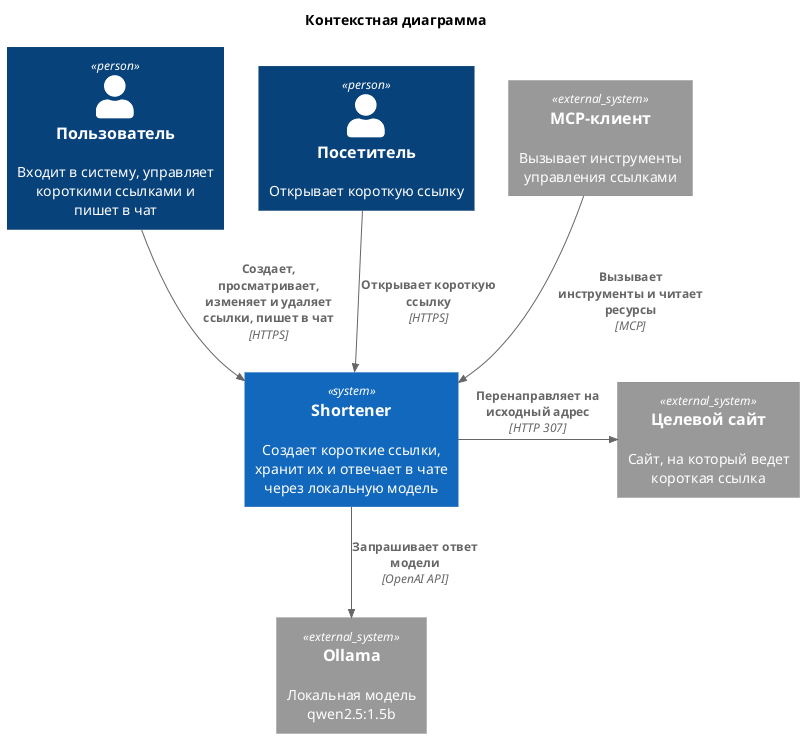
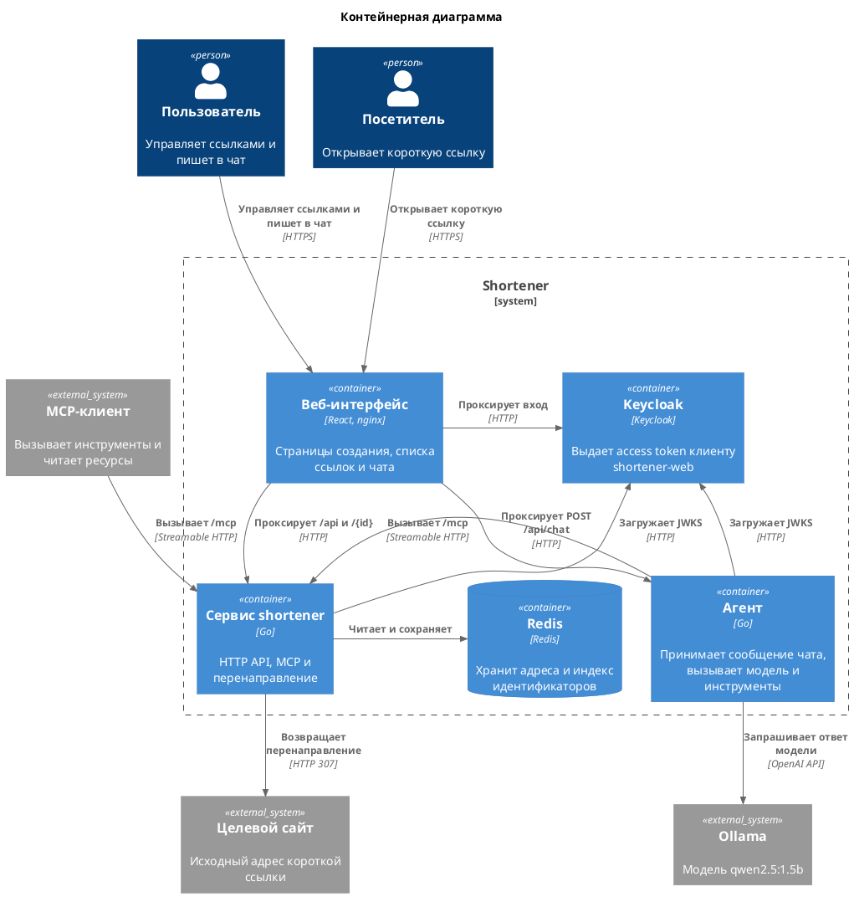
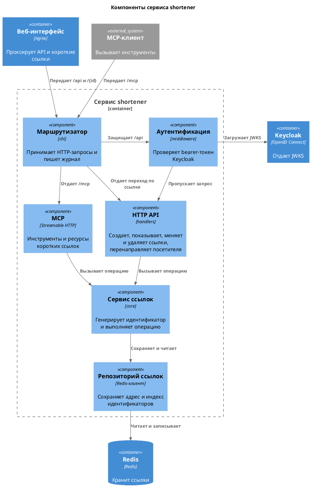
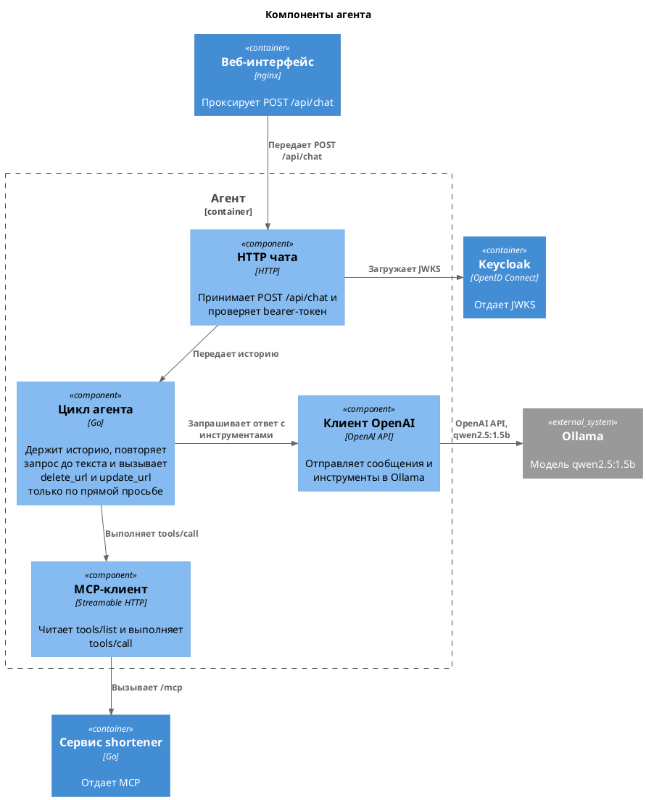
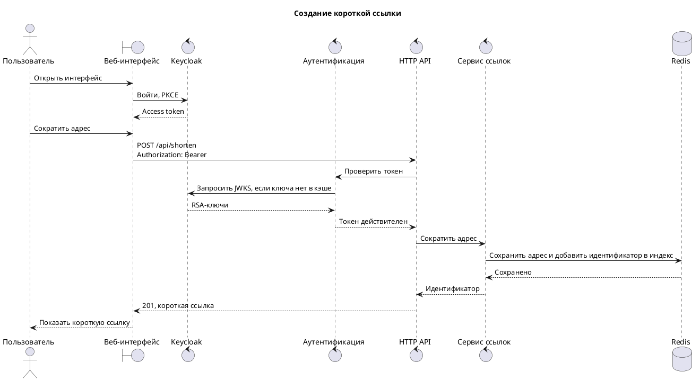
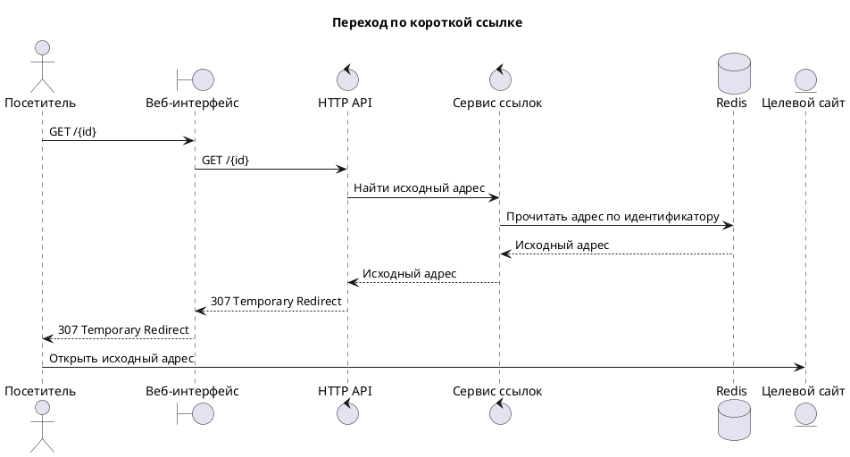
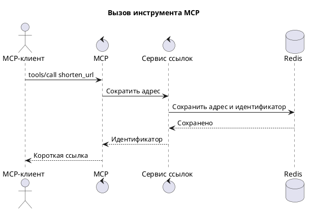
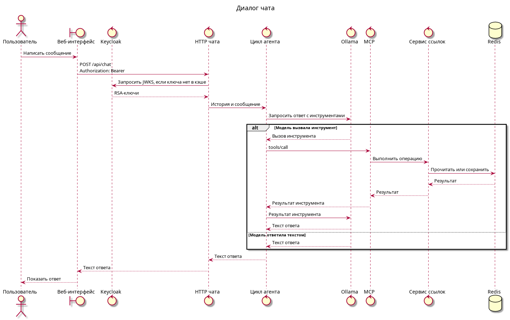
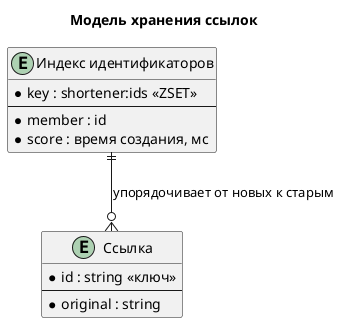

# Shortener

Сервис коротких ссылок. Пользователь входит через Keycloak и в веб-интерфейсе создает ссылку, смотрит список, меняет исходный адрес и удаляет ссылку. В чате агент спрашивает локальную модель Ollama и при необходимости вызывает те же операции. Посетитель открывает адрес из восьми букв и цифр и получает перенаправление на исходный сайт. Внешний MCP-клиент вызывает инструменты `shorten_url`, `list_urls`, `resolve_url`, `update_url`, `delete_url` и читает ресурсы ссылок.

Идентификатор генерируется случайно. Исходный адрес хранится в Redis по этому идентификатору, а порядок списка задает sorted set `shortener:ids`. Запросы `/api` и `POST /api/chat` требуют access token клиента `shortener-web`. Переход по короткой ссылке и `/mcp` открыты без токена.

## Контекст

[Исходный код диаграммы](schemas/system-context.puml)

## Контейнеры

[Исходный код диаграммы](schemas/system-containers.puml)

Веб-интерфейс на nginx отдает SPA и проксирует `/api`, `POST /api/chat`, идентификатор короткой ссылки и страницы Keycloak. Сервис на Go слушает HTTP API, MCP и редирект. Агент — отдельный процесс на Go в `cmd/agent`: он принимает сообщение чата, проверяет bearer-токен по JWKS, запрашивает Ollama по OpenAI API и вызывает `/mcp`. Локально он слушает `:8090` и ходит в Ollama на `127.0.0.1:11434`. В Docker Ollama — сервис `ollama`, агент ходит в нее по `http://ollama:11434/v1`. Keycloak выдает токен.

## Компоненты сервиса

[Исходный код диаграммы](schemas/shortener-components.puml)

## Компоненты агента

[Исходный код диаграммы](schemas/agent-components.puml)

Процесс `cmd/agent` слушает `:8090`. HTTP чата принимает `POST /api/chat` и проверяет токен. Страница присылает историю диалога, цикл повторяет запрос к модели, пока она не вернет текст. `delete_url` и `update_url` цикл вызывает только когда пользователь прямо просит изменить или удалить ссылку. Клиент OpenAI ходит в Ollama, модель `qwen2.5:1.5b`, адрес `http://127.0.0.1:11434/v1`. MCP-клиент читает `tools/list` и выполняет `tools/call`.

## Создание ссылки

[Исходный код диаграммы](schemas/shorten-sequence.puml)

## Переход по ссылке

[Исходный код диаграммы](schemas/redirect-sequence.puml)

## Вызов MCP

[Исходный код диаграммы](schemas/mcp-sequence.puml)

## Диалог чата

[Исходный код диаграммы](schemas/chat-sequence.puml)

## Модель хранения

[Исходный код диаграммы](schemas/storage-model.puml)
